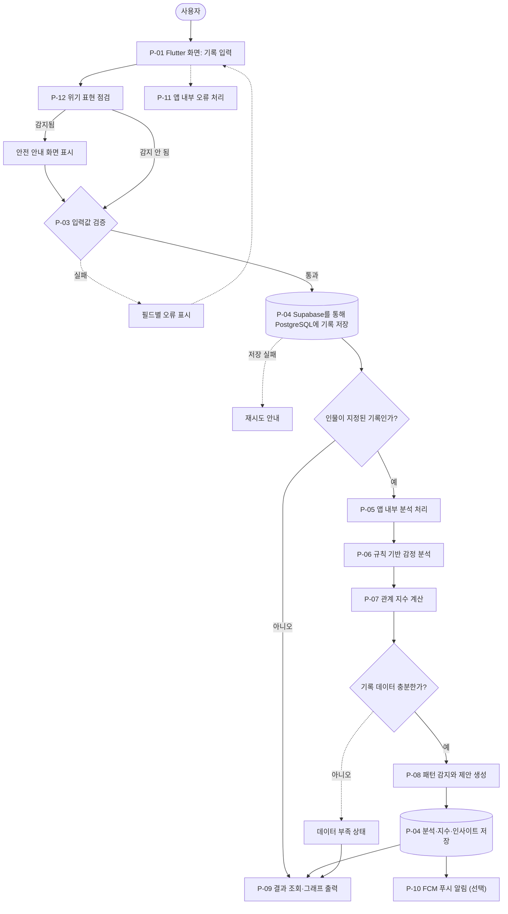
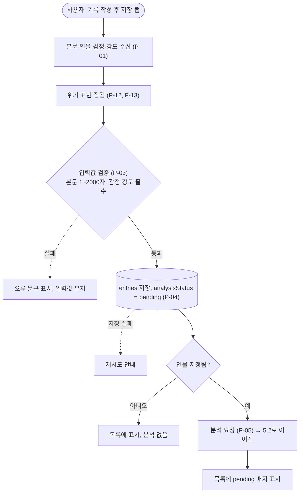
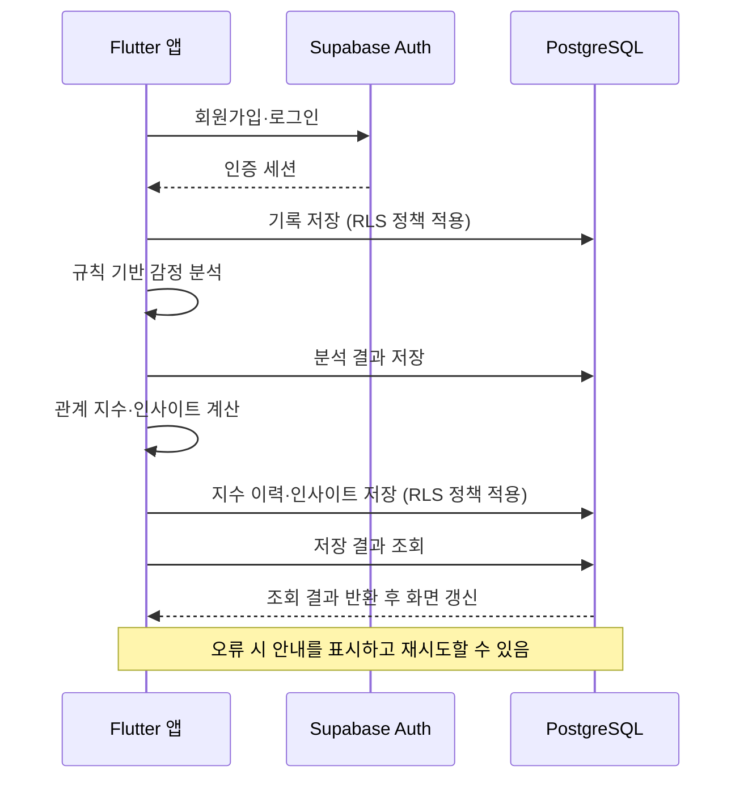
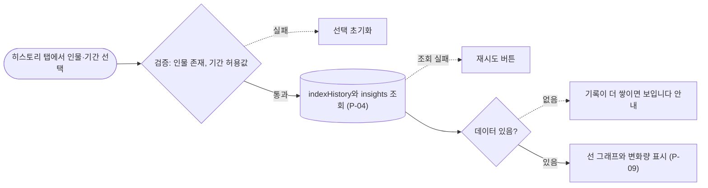
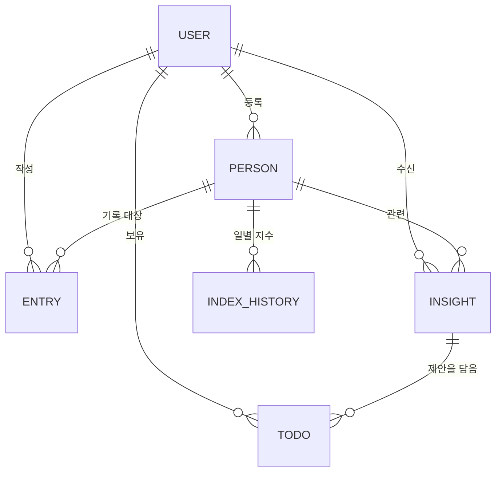
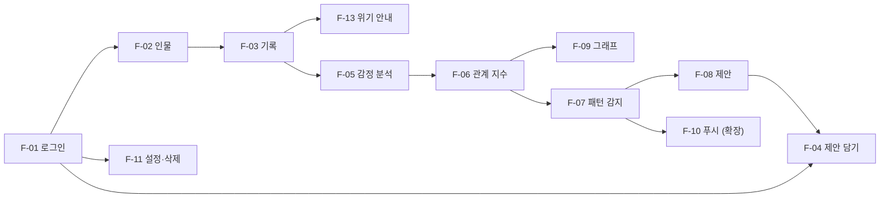

# 리본(Re:Born) 기능 명세서 및 파이프라인 설계 문서

2026/10/12 고희경

> 원본: [`ReBorn 명세서&파이프라인.docx`](./ReBorn%20명세서&파이프라인.docx) (2026-10-12)를 2026-10-15에 Markdown으로 옮겼습니다. 내용은 원본 그대로이며, 앞으로는 이 파일을 기준으로 수정합니다.
> 실제로 쓰는 기술 스택은 [TECH_STACK.md](./TECH_STACK.md)를 따릅니다. 변환하면서 찾은 불일치는 [맨 아래](#변환-중-발견한-불일치)에 정리했습니다.

리본은 개인의 감정과 행동을 기반으로 인간관계를 기록,분석하며 이를 통해 더 나은 관계 형성을 지원하는 감정 기반 인간관계 향상 앱입니다. 이 문서는 그 앱의 기능 명세서(F-ID)와 파이프라인(P-ID)을 서로 연결해 정리한 설계 기준서입니다.

## 1. 프로젝트 분석 및 요구사항

### 1.1 기획서 내용 요약

| 항목 | 내용 |
|---|---|
| 프로젝트명 | 리본(Re:Born) |
| 아이디어 | 감정·행동 기록을 바탕으로 인간관계를 분석하고 더 나은 관계 형성을 돕는 앱 |
| 해결할 문제 | 짧은 메시지·비대면 소통으로 감정 전달이 어려워 오해가 생기고, 감정과 행동을 돌아볼 도구가 부족함 |
| 주요 사용자 | 인간관계에 어려움을 느끼는 청소년·청년, 감정 관리와 소통에 도움이 필요한 사용자 |
| 핵심 목표 | 일상 속 감정·행동을 자연스럽게 기록하고 관계의 흐름 속에서 돌아보게 함 |
| 기획서의 기능 | 일기·메모, 체크리스트, 부정 감정 반복 감지 후 행동·대화 시점 제안, 긍정 상호작용 그래프 |
| 프론트엔드 | Flutter |
| 백엔드 | Supabase Auth + PostgreSQL |
| 배포 | Supabase |
| 분석 도구 | 사용하지 않음 |
| AI 분석 | 규칙 기반 분석 |
| 팀 | 4명: 이윤재(기획·프론트), 김규리(기획·백엔드), 고희경(기획·백엔드), 백하은(기획·UI/UX) |

### 1.2 핵심 문제

- 감정은 순간이지만 선택과 행동은 오래 남는데, 사용자가 자신의 감정과 행동을 돌아보는 과정에 익숙하지 않습니다.
- 감정은 반복되는데 이를 "누구와의 관계"라는 단위로 모아서 보여 주는 도구가 부족합니다.
- 그래서 리본의 핵심은 기록 → 인물별 누적 → 변화 감지 → 행동 제안 → 변화 확인의 순환입니다.

### 1.3 이용 시나리오

- 기록: 희경은 "하은이가 노트를 돌려줄 때 고맙다는 말이 없어 서운했다"를 메모하고, 인물에 "하은", 감정에 "서운함"을 선택합니다.
- 감지: 10일 정도 하은 관련 부정 기록이 쌓이면 앱이 "최근 하은 님과의 관계에서 부정적 기록이 늘었습니다"라고 알려 줍니다.
- 제안: 앱이 "오늘은 거리를 두고, 내일 가벼운 간식과 함께 말을 건네 보세요" 같은 행동을 제안합니다.
- 실천과 회복: 희경이 제안을 체크리스트에 담아 실천하고, 이후 긍정 기록이 늘어납니다.
- 확인: 학기 말에 관계 히스토리 그래프에서 하은과의 지수가 회복된 흐름을 확인합니다.

### 1.4 사용자 이용 전체 과정

- 앱 설치 후 회원가입·로그인, 개인정보·AI 분석 동의
- 관계를 기록할 인물 등록 (예: 하은, 친구, 가족)
- 일상에서 감정·행동 기록 작성 (인물·감정 선택 + 자유 메모)
- 기록 저장 후 자동 분석 (감정 점수, 키워드)
- 인물별 관계 지수 갱신
- 부정 패턴이 감지되면 인사이트와 행동 제안 확인
- 제안을 체크리스트에 추가해 실천, 완료 체크
- 관계 히스토리 탭에서 변화 확인
- 필요 시 기록·계정 삭제

### 1.5 요구사항 구분

| 구분 | 요구사항 | 관련 기능 |
|---|---|---|
| 핵심 | 로그인과 본인 데이터 분리 | F-01 |
| 핵심 | 인물 등록·관리 | F-02 |
| 핵심 | 감정·행동 기록 작성·조회·수정·삭제 | F-03 |
| 핵심 | 기록 기반 감정 분석과 관계 지수 계산 | F-05, F-06 |
| 핵심 | 부정 패턴 감지와 행동 제안 | F-07, F-08 |
| 핵심 | 관계 히스토리 그래프 | F-09 |
| 핵심 | 체크리스트 | F-04 |
| 핵심(제안) | 민감 표현 감지 시 안전 안내 | F-13 |
| 부가 | 푸시 알림 | F-10 |
| 부가 | 설정, 데이터 삭제·내보내기 | F-11 |
| 부가 | 사용 분석·오류 수집 | F-12 |
| 부가 | 규칙 기반 감정 분석 | F-05 확장 |

### 1.6 입력 · 처리 · 출력 분석

| 기능 | 입력 | 처리 | 출력 |
|---|---|---|---|
| 기록 | 본문, 인물, 감정, 날짜 | 검증 후 저장 | 저장된 기록, 목록 갱신 |
| 분석 | 기록 본문, 감정 선택값 | 감정 점수 산출, 키워드 추출 | 분석 결과(점수, 키워드) |
| 관계 지수 | 인물별 최근 분석 결과 | 기간 가중 평균 계산 | 0~100 지수, 일별 이력 |
| 감지·제안 | 지수 변화, 부정 기록 수 | 임계값 규칙 판정(일주일에 4번 이상 부정적인 기록을 한다면 작용) | 인사이트 카드, 행동 제안 |
| 그래프 | 인물, 기간 | 지수 이력 조회 | 선 그래프 |

### 1.7 불명확하거나 검토가 필요한 부분

- 개인정보: 일기에는 타인의 이름과 감정이 담깁니다. 민감한 정보이므로 암호화, 동의, 삭제 기능이 필요합니다. 만 14세 미만 사용자는 법정대리인 동의가 필요하므로 대상 연령 제한이 필요합니다(미정).
- 의료 서비스가 아님을 앱에서 밝히고, 자해·위기 표현에 대한 안내 방식이 필요합니다.

## 2. 전체 기능 목록

기능은 13개이며, 우선순위는 MVP 기준(9장)입니다. F-13은 기획서에 없는 제안 기능입니다.

| ID | 기능명 | 한 줄 설명 | 우선순위 | 출처 |
|---|---|---|---|---|
| F-01 | 회원가입·로그인 | 계정 생성, 로그인, 로그아웃 | 필수 | 노션 |
| F-02 | 인물 관리 | 관계를 기록할 사람 등록·수정·삭제 | 필수 | 기획서(특정 인물 관계) |
| F-03 | 감정·행동 기록 | 일기·메모 작성, 인물·감정 선택, 조회·수정·삭제 | 필수 | 노션 |
| F-04 | 체크리스트 | 할 일 추가, 완료 체크, 행동 제안 담기 | 필수 | 노션 |
| F-05 | 기록 감정 분석 | 기록에서 감정 점수와 키워드 산출 | 필수 | 기획서 |
| F-06 | 관계 지수 계산 | 인물별 0~100 지수와 일별 이력 생성 | 필수 | 기획서(관계 지수) |
| F-07 | 부정 패턴 감지·인사이트 | 반복되는 부정 기록을 규칙으로 감지해 카드 생성 | 필수 | 기획서 |
| F-08 | 행동·대화 시점 제안 | 감지 결과에 맞는 행동 문구 제안 | 권장 | 기획서 |
| F-09 | 관계 히스토리 그래프 | 인물별 지수 변화를 선 그래프로 표시 | 필수 | 노션 |
| F-10 | 푸시 알림 | 기록 리마인드, 인사이트 도착 알림 | 선택 | 기획서(제안 시점) |

## 3. 상세 기능 명세서

### F-01 회원가입·로그인

| 항목 | 내용 |
|---|---|
| 목적 | 사용자별로 기록을 분리해 보호한다 |
| 사용자·조건 | 모든 사용자, 앱 최초 실행 또는 로그아웃 상태 |
| 입력 | 이메일, 비밀번호 (구글 로그인은 선택) |
| 검증 | 이메일 형식,  필수 동의(개인정보, AI 분석, 알림) |
| 처리 로직 | 1) 클라이언트 검증 2) Supabase Auth에 계정 생성 또는 로그인 3) 신규 가입이면 users/{uid} 문서 생성 4) 토큰을 받아 이후 요청에 사용 |
| 출력 | 홈 화면 이동, 실패 시 오류 문구 |
| 저장·조회 | 저장: 사용자 문서(uid, 가입일, 동의 여부, 닉네임). 비밀번호는 Supabase Auth가 관리하며 직접 저장하지 않음 |
| 연동 | Supabase Auth, PostgreSQL |
| 정상 흐름 | 입력 → 검증 → 인증 성공 → 홈 |
| 예외 | 이미 가입된 이메일, 비밀번호 오류, 네트워크 끊김 → 해당 문구 표시 후 재시도 가능 |
| 보안 | 비밀번호 평문 저장 금지, 로그인 실패 횟수 제한은 Supabase Auth 기본 기능 사용 |
| 우선순위 | 필수 |
| 검증 기준 | 가입 후 로그인되고, 다른 계정의 데이터가 보이지 않는다 |
| 파이프라인 | P-01, P-02, P-03, P-11 |

### F-02 인물 관리

| 항목 | 내용 |
|---|---|
| 목적 | 기록과 관계 지수를 묶는 단위(인물)를 만든다 |
| 사용자·조건 | 로그인한 사용자 |
| 입력 | 이름(별칭), 관계 유형(친구·가족·선생님·동료·기타), 메모(선택) |
| 검증 | 이름 1~20자, 인물 수 제안(5명) |
| 출력 | 인물 목록 화면 |
| 저장·조회 | 저장·조회 모두 PostgreSQL |
| 연동 | F-03(인물 선택), F-06(인물별 지수) |
| 정상 흐름 | 추가 → 목록에 표시 → 기록 작성 시 선택 가능 |
| 예외 | 글자 수 초과, 저장 실패 → 안내 후 입력값 유지 |
| 보안 | 실명 대신 별칭 사용을 권장하는 문구 표시 |
| 우선순위 | 필수 |
| 검증 기준 | 추가·수정·삭제가 목록에 즉시 반영되고 중복 이름이 거부된다 |
| 파이프라인 | P-01, P-03, P-04 |

### F-03 감정·행동 기록

| 항목 | 내용 |
|---|---|
| 목적 | 일상의 감정과 행동을 인물과 함께 기록한다 (서비스의 핵심 입력) |
| 사용자·조건 | 로그인한 사용자 |
| 입력 | 본문(필수), 인물(선택, 1명), 감정 종류(필수), 작성 일시(기본 현재) |
| 검증 | 감정 선택 필수, 인물이 있으면 존재하는 인물인지 확인, 미래 날짜 불가 |
| 처리 로직 | 1) 검증 2) entries 문서 저장(analysisStatus = pending) 3) 인물이 있으면 P-05로 분석 요청 4) 분석 완료 시 화면이 자동 갱신 5) 기록을 수정·삭제하면 지수 재계산로 해당 인물의 지수를 다시 계산하고, 본문을 수정했으면 다시 분석 |
| 감정 점수 | 긍정(+1). 중립(0), 부정(-1) |
| 출력 | 기록 목록, 상세 화면, 분석 완료 배지 |
| 저장·조회 | PostgreSQL users/{uid}/entries/{entryId}: 본문, personId, 감정, 강도, score, createdAt, analysisStatus |
| 연동 | F-02, F-05, F-13 |
| 정상 흐름 | 작성 → 저장 → 목록 표시 → (인물 있으면) 분석 → 지수 갱신 |
| 예외 | 본문 비어 있음·글자 초과 → 저장 불가 안내. 네트워크 오류 → 임시 저장 후 재시도(PostgreSQL 오프라인 캐시 사용, 가능 여부 확인 필요). 분석 실패 → 기록은 유지하고 analysisStatus = failed 표시 |
| 보안 | 본문은 본인만 읽을 수 있도록 Supabase RLS 정책 설정, 분석 도구(외부 분석 도구)로 본문 전송 금지 |
| 우선순위 | 필수 |
| 검증 기준 | 저장한 기록이 앱 재실행 후에도 조회되고, 수정·삭제가 반영되며, 타 계정에서 접근되지 않는다 |
| 파이프라인 | P-01, P-03, P-04, P-05, P-12 |

### F-04 체크리스트

| 항목 | 내용 |
|---|---|
| 목적 | 할 일과 행동 제안 실천 여부를 체크한다 |
| 사용자·조건 | 로그인한 사용자 |
| 입력 | 제목, 연결 인물(선택), 출처(직접 입력 또는 F-08 제안) |
| 검증 | 제목 1~100자 |
| 처리 로직 | 저장 후 목록에 표시, 체크 시 done = true와 완료 시각 기록 |
| 출력 | 체크리스트 화면, 완료율 |
| 저장·조회 | PostgreSQL users/{uid}/todos/{todoId} |
| 연동 | F-08(제안 담기), F-02 |
| 정상 흐름 | 추가 → 체크 → 완료 상태 저장 |
| 예외 | 빈 제목·저장 실패 → 안내, 체크 상태는 실패 시 원래대로 되돌림 |
| 보안 | 본인 데이터만 접근 |
| 우선순위 | 필수 |
| 검증 기준 | 추가·체크·삭제가 재실행 후에도 유지된다 |
| 파이프라인 | P-01, P-03, P-04 |

### F-05 기록 감정 분석

| 항목 | 내용 |
|---|---|
| 목적 | 기록에서 관계 지수에 쓸 감정 점수와 키워드를 만든다 |
| 사용자·조건 | 인물이 지정된 기록이 저장되었을 때 자동 실행 |
| 입력 | entryId, 본문, 사용자가 고른 감정·강도 |
| 검증 | 요청자의 토큰 확인, entry가 요청자 소유인지 확인 |
| 출력 | analysis 필드(점수, 키워드, 분석 방식, 분석 시각) |
| 저장·조회 | 저장: PostgreSQL entry 문서 |
| 정상 흐름 | 요청 → 토큰 검증 → 분석 → 저장 → analysisStatus = done |
| 예외 | 분석 처리 오류 → failed 표시 후 재시도 버튼 |
| 보안 | 외부 AI 서비스로 기록 본문을 전송하지 않음 |
| 우선순위 | 필수(규칙 기반) |
| 검증 기준 | 같은 입력에 같은 결과가 나오고(규칙 기반), 결과가 entry에 저장된다 |
| 파이프라인 | P-05, P-06, P-04 |

### F-06 관계 지수 계산

| 항목 | 내용 |
|---|---|
| 목적 | 인물별 관계 상태를 0~100 숫자로 만들어 변화를 추적한다 (기획서의 "관계 지수") |
| 사용자·조건 | F-05 분석 완료 후 앱에서 실행 |
| 입력 | personId, 해당 인물의 최근 14일 기록 점수(−3~+3)와 작성일 |
| 검증 | 3개 데이터 미만이면 "데이터 부족" |
| 출력 | 오늘의 지수, 직전 값 대비 변화량 |
| 저장·조회 | PostgreSQL people/{personId}/indexHistory/{yyyy-MM-dd}: index, entryCount, computedAt |
| 연동 | F-05(입력), F-07·F-09(사용) |
| 정상 흐름 | 분석 완료 → 14일 기록 조회 → 계산 → 저장 |
| 예외 | 기록 3건 미만 → 저장하지 않고 "데이터 부족" 상태 반환. 기록 수정·삭제 시에도 재계산 |
| 보안 | 본인 인물 데이터만 계산 |
| 우선순위 | 필수 |
| 검증 기준 | 같은 기록 묶음에서 항상 같은 지수가 나오고, 직접 계산한 값과 일치한다 |
| 파이프라인 | P-07, P-04 |

### F-07 부정 패턴 감지·인사이트

| 항목 | 내용 |
|---|---|
| 목적 | 특정 인물과의 부정 기록이 반복되면 알려 주고, 긍정 변화도 알려 준다 |
| 사용자·조건 | F-06 지수 계산 직후 앱에서 실행 |
| 입력 | personId, 최근 10일 기록 점수, 지수 이력 |
| 검증 | 같은 인물·같은 유형 인사이트가 최근 7일 안에 이미 있으면 새로 만들지 않음 |
| 처리 로직 | 부정 추세: 최근 10일 중 점수 −1 이하 기록이 3건 이상이고 지수가 10일 전보다 10점 이상 낮을 때. 회복 추세: 지수가 14일 전보다 10점 이상 높을 때. 임계값은 팀 테스트로 조정 |
| 출력 | 인사이트 카드: 유형, 인물, 문구, 근거 수치(기록 수, 지수 변화) |
| 문구 원칙 | 수치는 계산값만 사용한다. 기획서 예시의 "피로도 40% 상승"처럼 정의되지 않은 수치는 쓰지 않는다 |
| 저장·조회 | PostgreSQL users/{uid}/insights/{insightId}: type, personId, message, evidence, createdAt, read |
| 연동 | F-06, F-08, F-10 |
| 정상 흐름 | 지수 계산 → 규칙 판정 → 인사이트 저장 → 홈 화면에 표시 |
| 예외 | 조건 미충족 → 생성 없음. 저장 실패 → 다음 분석 때 재판정 |
| 보안 | 인사이트에 일기 본문을 복사하지 않음 |
| 우선순위 | 필수 |
| 검증 기준 | 조건을 만족하는 테스트 데이터에서 카드가 1개 생성되고, 중복 생성되지 않는다 |
| 파이프라인 | P-08, P-04 |

### F-08 행동·대화 시점 제안

| 항목 | 내용 |
|---|---|
| 목적 | 인사이트에 맞는 구체적인 행동을 제안한다 |
| 사용자·조건 | 인사이트 카드를 열었을 때 |
| 입력 | 인사이트 유형, 인물, (선택) 최근 키워드 |
| 검증 | 해당 유형에 맞는 문구가 존재하는지 확인 |
| 출력 | 제안 카드와 "체크리스트에 담기" 버튼 |
| 저장·조회 | 문구 풀은 Flutter 앱 내부에 둡니다. 담기를 누르면 F-04 항목이 생성됨 |
| 연동 | F-07, F-04 |
| 정상 흐름 | 카드 열기 → 제안 표시 → 담기 → 체크리스트에 추가 |
| 예외 | 문구가 없으면 기본 문구("잠시 감정을 정리하고 천천히 대화해 보세요") 표시 |
| 보안 | 단정적 표현("~해야 합니다") 대신 권유 표현 사용 |
| 우선순위 | 권장 |
| 검증 기준 | 모든 인사이트 유형에 제안이 1개 이상 표시되고, 담기 후 체크리스트에 나타난다 |
| 파이프라인 | P-08, P-04, P-01 |

### F-09 관계 히스토리 그래프

| 항목 | 내용 |
|---|---|
| 목적 | 인물별 관계 지수의 변화를 눈으로 확인하게 한다 |
| 사용자·조건 | 로그인한 사용자가 히스토리 탭에서 인물 선택 |
| 입력 | personId, 기간(1주·1개월·3개월·전체) |
| 검증 | 인물 존재 여부, 기간 값이 허용 범위인지 확인 |
| 처리 로직 | 기간 내 indexHistory를 날짜순으로 조회해 선 그래프로 그림. 기록이 없는 날은 직전 값을 이어서 표시(제안) |
| 출력 | 선 그래프, 시작 대비 현재 변화량, 해당 기간 인사이트 목록 |
| 저장·조회 | PostgreSQL 조회만 수행 |
| 연동 | F-06, F-07 |
| 정상 흐름 | 인물 선택 → 조회 → 그래프 표시 |
| 예외 | 데이터 없음 → "기록이 더 쌓이면 그래프가 보입니다" 안내. 조회 실패 → 재시도 버튼 |
| 보안 | 본인 인물만 조회 |
| 우선순위 | 필수 |
| 검증 기준 | 화면 그래프의 값이 DB의 지수 값과 같다 |
| 파이프라인 | P-09, P-04 |

### F-10 푸시 알림

| 항목 | 내용 |
|---|---|
| 목적 | 기록 리마인드와 인사이트 도착을 알린다 |
| 사용자·조건 | 알림 권한을 허용한 사용자 |
| 입력 | FCM 기기 토큰, 알림 시각(설정), 알림 유형 |
| 검증 | 알림 설정이 켜져 있는지 확인, 하루 최대 2회(제안) |
| 처리 로직 | 인사이트 생성 시 또는 설정 시각에 FCM으로 발송. 알림에 일기 내용은 넣지 않음 |
| 출력 | 푸시 알림, 눌렀을 때 해당 화면으로 이동 |
| 저장·조회 | 기기 토큰과 알림 설정을 사용자 문서에 저장 |
| 연동 | FCM, F-07 |
| 정상 흐름 | 조건 발생 → 발송 → 탭 → 화면 이동 |
| 예외 | 권한 거부·토큰 만료 → 발송 건너뜀, 앱 내 인사이트로만 확인 |
| 보안 | 잠금 화면에 민감 내용이 보이지 않게 일반 문구 사용 |
| 우선순위 | 선택 |
| 검증 기준 | 테스트 기기에서 알림이 도착하고 올바른 화면이 열린다 |
| 파이프라인 | P-10 |

### F-11 설정·데이터 관리

| 항목 | 내용 |
|---|---|
| 목적 | 사용자가 자신의 데이터와 동의를 통제하게 한다 |
| 사용자·조건 | 로그인한 사용자 |
| 입력 | 동의 on/off, 삭제 요청(기록 전체 또는 계정), 재인증 비밀번호 |
| 검증 | 계정 삭제 전 재인증, 삭제 전 확인 팝업 |
| 처리 로직 | 동의 철회 시 해당 분석 중단. 계정 삭제 시 사용자 데이터 삭제 요청을 처리하고 Supabase Auth 계정 삭제 절차를 진행 |
| 출력 | 삭제 완료 안내 후 로그인 화면 |
| 저장·조회 | 동의 상태 저장 |
| 연동 | F-01, Flutter 앱(삭제 처리) |
| 정상 흐름 | 요청 → 재인증 → 삭제 → 로그아웃 |
| 예외 | 삭제 중 실패 → 남은 항목 재시도 안내 |
| 보안 | 삭제는 복구 불가임을 알림 |
| 우선순위 | 필수(동의·삭제) |
| 검증 기준 | 계정 삭제 후 해당 uid의 문서가 DB에 남지 않는다 |
| 파이프라인 | P-01, P-02, P-04 |

### F-12 사용 분석·오류 수집

| 항목 | 내용 |
|---|---|
| 목적 | 사용 흐름과 오류를 파악해 품질을 개선한다 |
| 사용자·조건 | 앱 실행 중, 분석 동의한 사용자 |
| 입력 | 화면 이동, 버튼 이벤트 이름, 오류 정보 |
| 검증 | 이벤트에 본문·이름 등 개인 내용이 없는지 코드 리뷰로 확인 |
| 처리 로직 | 외부 분석 도구에 이벤트 이름만 전송(예: entry_saved). 앱 내부 오류 처리에 오류 스택 전송, 본문은 마스킹 |
| 출력 | 대시보드(개발팀용) |
| 저장·조회 | 외부 서비스에 저장 |
| 우선순위 | 선택 (앱 내부 오류 처리는 권장) |
| 예외 | 전송 실패 시 앱 동작에 영향 없음 |
| 검증 기준 | 테스트 중 이벤트가 대시보드에 도착하고 본문이 포함되지 않는다 |
| 파이프라인 | P-11 |

## 4. 시스템 파이프라인

리본은 Flutter 앱에서 입력을 검증하고 Supabase Auth로 사용자를 인증한 뒤, PostgreSQL에 데이터를 저장·조회하는 구조입니다. 사용자별 데이터 접근은 Supabase RLS 정책으로 제한합니다. 감정 분석과 관계 지수 계산은 앱에서 규칙 기반으로 처리하고 결과를 PostgreSQL에 저장합니다.

### 4.1 파이프라인 단계표

| ID | 단계명 | 수행 목적 | 입력 | 처리 작업 | 출력 | 다음 단계 | 관련 기능 | 실패 시 |
|---|---|---|---|---|---|---|---|---|
| P-01 | 사용자 인터페이스 | 입력 수집, 결과 표시 | 사용자 조작 | Flutter 화면 입력·출력 | 입력값, 화면 | P-03 / P-09 | F-01~F-04, F-11 | 오류 문구 표시 |
| P-02 | 인증 | 사용자 식별 | 이메일, 비밀번호 | Supabase Auth 로그인, 토큰 발급 | uid, 토큰 | P-01 | F-01, F-11 | 로그인 실패 안내 |
| P-03 | 입력값 검증 | 잘못된 데이터 차단 | 화면 입력값 | 글자 수, 필수값, 형식 검사 | 검증 통과 데이터 | P-04 | F-01~F-04 | 필드별 오류 표시, 저장 안 함 |
| P-04 | 저장·조회 | 데이터 보관 | 검증된 데이터, 조회 조건 | PostgreSQL 읽기·쓰기 (보안 규칙 적용) | 저장 확인, 조회 결과 | P-05 / P-09 | 전체 | 재시도 버튼, 오프라인 캐시 |
| P-05 | 분석 요청 | 앱 내부 분석 처리 시작 | entryId, 토큰 | Flutter 앱 내부 처리 호출, 토큰·소유자 확인 | 접수 응답 | P-06 | F-03, F-05 | 실패 시 analysisStatus = failed, 재시도 |
| P-06 | 감정 분석 | 기록에서 점수·키워드 생성 | 본문, 감정, 강도 | 규칙 기반 분석 | analysis 결과 | P-07 | F-05 | 분석 실패 시 규칙 결과로 대체 |
| P-07 | 관계 지수 계산 | 인물별 지수 산정 | 최근 14일 점수 | 가중 평균 계산 | 일별 지수 | P-08 | F-06 | 7건 미만이면 "데이터 부족" |
| P-08 | 패턴 감지·제안 | 인사이트와 행동 제안 생성 | 지수, 10일 점수 | 임계값 규칙, 문구 선택 | 인사이트 문서 | P-10 / P-09 | F-07, F-08 | 생성 건너뜀, 다음 분석 때 재판정 |
| P-09 | 결과 조회·출력 | 결과를 화면에 표시 | personId, 기간 | 지수 이력·인사이트 조회, 그래프 그리기 | 그래프, 카드 | 종료 | F-08, F-09 | "데이터 없음" 안내 |
| P-10 | 알림 발송 | 인사이트·리마인드 전달 | 기기 토큰, 알림 설정 | FCM 발송 | 푸시 알림 | 종료 | F-10 | 발송 건너뜀 |
| P-11 | 로그·오류·사용 분석 | 품질 관리 | 오류, 이벤트 이름 | 앱 내부 오류 처리, 외부 분석 도구 전송 (본문 제외) | 로그 | 종료 | F-12 (전 단계 공통) | 전송 실패는 무시 |
| P-12 | 위기 표현 점검 | 안전 안내 | 기록 본문 | 앱 내 키워드 목록 비교 | 안내 화면 | P-04 | F-13, F-03 | 점검 실패해도 저장은 진행 |

### 4.2 시스템 흐름도

실선은 정상 흐름, 점선은 실패·예외 흐름입니다. 마름모는 조건 분기입니다.

로그인(P-02)은 앱 시작 시 한 번 거치며, 이후 모든 요청에 토큰이 따라갑니다.

## 5. 기능별 처리 파이프라인

복잡한 핵심 기능은 도표로, 단순한 기능은 표로 정리했습니다. 각 단계 옆의 ID는 3장의 기능 명세와 4장의 단계표를 가리킵니다.

### 5.1 F-03 기록 작성·저장

### 5.2 F-05 → F-06 → F-07 → F-08 분석 체인

앱이 기록을 저장한 뒤 규칙 기반 분석과 관계 지수 계산을 수행하고 결과를 PostgreSQL에 저장합니다. 저장 결과를 다시 조회해 화면을 갱신합니다.

| 단계 | 기능 | 입력 | 출력 | 실패 처리 |
|---|---|---|---|---|
| 토큰·소유자 확인 | F-05 | 토큰, entryId | 통과 여부 | 401/403 응답, failed |
| 감정 분석 | F-05 | 본문, 감정, 강도 | score, keywords | 규칙 기반으로 처리 |
| 지수 계산 | F-06 | 14일 score | index | 3건 미만이면 "데이터 부족" |
| 패턴 판정 | F-07 | 10일 score, 지수 이력 | insight 또는 없음 | 건너뜀 |
| 제안 선택 | F-08 | insight 유형 | 제안 문구 | 기본 문구 사용 |

### 5.3 F-09 관계 히스토리 그래프

### 5.4 단순 기능 (표)

| 기능 | 처리 순서 (파이프라인 ID) | 실패 시 |
|---|---|---|
| F-01 로그인 | 입력(P-01) → 검증(P-03) → Supabase Auth(P-02) → 사용자 문서 생성·조회(P-04) → 홈 | 오류 문구, 재시도 |
| F-02 인물 관리 | 입력(P-01) → 검증(P-03) → 저장·수정·삭제(P-04) → 목록 갱신(P-01) | 입력값 유지, 안내 |
| F-04 체크리스트 | 입력(P-01) → 검증(P-03) → 저장(P-04) → 체크 시 done 갱신(P-04). 제안 담기: 인사이트 카드(P-08) → 저장(P-04, source = suggestion) | 체크 상태 되돌림 |
| F-10 푸시 알림 | 인사이트 저장(P-08) → 설정 확인 → FCM 발송(P-10) → 탭 시 화면 이동(P-01) | 발송 건너뜀 |
| F-11 계정 삭제 | 요청(P-01) → 재인증(P-02) → 사용자 데이터 삭제 처리(P-04) → Auth 삭제(P-02) → 로그인 화면 | 남은 항목 재시도 안내 |
| F-12 분석·오류 | 이벤트·오류 발생 → 본문 제외 후 전송(P-11) | 무시 |
| F-13 위기 표현 | 저장 시 키워드 비교(P-12) → 감지 시 안내 화면(P-01) → 저장 진행(P-04) | 점검 실패해도 저장 진행 |

## 6. 데이터 흐름 및 저장 처리 설계

기술 스택은 Flutter, Supabase Auth, PostgreSQL, Supabase RLS, Firebase Cloud Messaging(FCM), SwiftUI, WidgetKit, ActivityKit 및 Android 알림 기능으로 구성합니다. 앱은 Supabase를 통해 데이터를 저장·조회하고, 분석과 관계 지수 계산은 앱에서 규칙 기반으로 처리합니다. 별도의 서버 프레임워크나 외부 AI API는 사용하지 않습니다.

### 6.1 데이터 흐름

- 사용자가 입력한 값을 Flutter 앱에서 검증한 뒤 Supabase를 통해 PostgreSQL에 저장합니다.
- Flutter 앱은 저장된 기록을 바탕으로 규칙 기반 감정 분석을 수행합니다. 별도의 분석 API나 서버 프레임워크는 사용하지 않습니다.
- Supabase Auth로 사용자를 인증하고 Supabase RLS 정책으로 사용자별 데이터 접근을 제한합니다.
- Flutter 앱은 분석 결과·관계 지수·인사이트를 Supabase를 통해 PostgreSQL에 저장하고, 필요한 데이터를 조회해 화면을 갱신합니다.
- 앱은 해당 문서를 구독하고 있다가 변경이 오면 화면을 갱신합니다.

### 6.2 저장 데이터 항목 (PostgreSQL)

사용자 데이터는 PostgreSQL의 사용자별 관계 테이블에 저장하고, 사용자 식별자와 Supabase RLS 정책으로 사용자 간 데이터 접근을 분리합니다.

| 컬렉션 | 필드 (자료형) | 쓰는 쪽 |
|---|---|---|
| users/{uid} | nickname (문자열), createdAt (시각), consents (객체: privacy, aiAnalysis, analytics 불리언 + 동의 시각), fcmToken (문자열, 선택), notifyTime ("HH:mm", 선택) | 앱 |
| people/{personId} | name (문자열), relationType (friend/family/teacher/coworker/other), memo (문자열, 선택), createdAt | 앱 |
| entries/{entryId} | body (문자열), personId (문자열 또는 null), emotion (문자열), intensity (정수 1~3), score (정수 −3~3), createdAt (시각), analysisStatus (pending/done/failed), analysis (객체: keywords 문자열 배열, method rule, analyzedAt) | 앱(기본 필드 및 분석 결과) |
| people/{personId}/indexHistory/{yyyy-MM-dd} | index (정수 0~100), entryCount (정수), computedAt (시각) | 서버 |
| insights/{insightId} | type (negative_trend/recovery), personId, message (문자열), evidence (객체: negCount, indexFrom, indexTo), createdAt, read (불리언) | 앱(생성 및 조회) |
| todos/{todoId} | title (문자열), personId (선택), done (불리언), doneAt (시각, 선택), source (manual/suggestion), createdAt | 앱 |

### 6.3 데이터 간 관계

### 6.4 Flutter 앱과 Supabase 데이터 처리 방식

| 작업 | 방식 | 이유 |
|---|---|---|
| 기록·인물·체크리스트 CRUD, 조회 | Flutter 앱 → Supabase → PostgreSQL | Supabase Auth와 RLS 정책으로 인증 및 사용자별 접근 제어 |
| 분석 요청, 재계산, 계정 삭제 | Flutter 앱 내부 규칙 기반 처리 | 감정 분석·관계 지수·인사이트 계산을 앱에서 수행 |
| 분석 결과 받기 | Supabase를 통한 PostgreSQL 조회 | 저장된 결과를 조회해 화면 갱신 |

### 6.5 앱 내부 처리 목록

| 처리 ID | 처리 방식 | 목적 | 관련 기능 |
|---|---|---|---|
| 분석 처리 | Flutter 앱 내부 규칙 기반 처리 | 기록 1건 분석 및 관계 지수 갱신 | F-05~F-08 |
| 지수 재계산 | Flutter 앱 내부 계산 | 기록 수정·삭제 후 지수 재계산 | F-06, F-07 |
| 계정 삭제 | Supabase Auth 및 사용자 데이터 삭제 절차 | 사용자 데이터와 계정 삭제 | F-11 |

| 처리 ID | 입력 | 성공 결과 | 오류 처리 |
|---|---|---|---|
| 분석 처리 | 저장된 기록 ID | 분석 결과 및 상태 저장 | 입력값·권한·저장 오류 안내 |
| 지수 재계산 | 인물 ID 및 관련 기록 | 관계 지수 또는 데이터 부족 상태 | 데이터 없음·계산 오류 안내 |
| 계정 삭제 | 사용자 확인 및 재인증 | 삭제 완료 안내 | 실패 시 안내 및 재시도 절차 |

각 처리 단계의 오류는 앱에서 사용자에게 안내하고, 재시도할 수 있는 경우 재시도 기능을 제공합니다.

### 6.6 저장하는 정보와 저장하지 않는 정보

| 저장 | 저장하지 않음 |
|---|---|
| 기록 본문, 감정, 점수, 분석 결과, 지수 이력, 인사이트 | 비밀번호(Supabase Auth가 관리) |
| 동의 상태, FCM 토큰 | 외부 AI 서비스로 전송하는 기록 본문 없음 |
| 체크리스트 | 분석 도구(GA, 외부 분석 도구)로 보낸 본문·인물 이름 |
|  | 위기 표현 감지 여부 |

### 6.7 외부 AI 모델 처리

- MVP에서는 외부 AI 모델을 사용하지 않고, 사용자가 선택한 감정과 미리 정한 규칙으로 분석합니다.
- 기록 본문을 외부 AI 서비스로 전송하지 않습니다.
- 감정 분석과 키워드 처리는 Flutter 앱에서 규칙 기반으로 수행합니다.
- 분석 결과를 계산할 수 없으면 실패 상태를 표시하고 다시 시도할 수 있도록 합니다.
- 외부 AI API를 사용하지 않으므로 AI API 호출 횟수나 비용 제한은 적용하지 않습니다.

### 6.8 개인정보·인증 정보 보호

- Supabase RLS 정책: 로그인한 사용자가 본인 데이터에만 접근하도록 테이블별 정책을 설정합니다.
- 인증·접근 제어: Supabase Auth로 사용자를 인증하고 Supabase RLS 정책으로 본인 데이터만 접근하도록 제한합니다.
- 외부 AI API를 사용하지 않으며, 분석은 앱 내부의 규칙 기반으로 처리합니다.
- 전송 암호화: Supabase 연결은 HTTPS를 사용합니다.
- 오류 처리: 오류 안내는 앱에서 표시하며, 기록 본문이나 인물 이름을 외부 분석 도구로 전송하지 않습니다.
- 동의·삭제: 가입 시 동의를 받고(F-01), 사용자가 직접 삭제할 수 있게 합니다(F-11).
- 연령: 만 14세 미만의 가입 제한 또는 법정대리인 동의 방식은 미정입니다.

## 7. 기능 명세서와 파이프라인의 연결표

표가 넓어지지 않도록 두 장으로 나눴습니다. 7.1은 "어디서 실행되는가", 7.2는 "무엇이 오가고 어떻게 확인하는가"입니다.

### 7.1 기능 ↔ 파이프라인 ↔ 단계

| 기능 ID | 기능명 | 파이프라인 | 실행 단계 (순서) | 예외 처리 단계 |
|---|---|---|---|---|
| F-01 | 회원가입·로그인 | P-01, P-02, P-03, P-04, P-11 | 입력 → 검증 → 인증 → 사용자 문서 생성 | P-03 오류 표시, P-02 인증 실패 안내 |
| F-02 | 인물 관리 | P-01, P-03, P-04 | 입력 → 검증 → 저장 → 목록 갱신 | P-03 중복·길이 오류 |
| F-03 | 감정·행동 기록 | P-01, P-12, P-03, P-04, P-05 | 입력 → 위기 점검 → 검증 → 저장 → 분석 요청 | P-03 오류, P-04 재시도, P-05 failed |
| F-04 | 체크리스트 | P-01, P-03, P-04 | 입력 → 검증 → 저장 → 체크 갱신 | 체크 되돌림 |
| F-05 | 기록 감정 분석 | P-05, P-06, P-04 | 요청 → 토큰·소유자 확인 → 분석 → 저장 | 권한 오류, 분석 실패 표시 후 재시도 |
| F-06 | 관계 지수 계산 | P-07, P-04 | 14일 점수 조회 → 계산 → 저장 | 3건 미만 "데이터 부족" |
| F-07 | 부정 패턴 감지 | P-08, P-04 | 판정 → 중복 확인 → 인사이트 저장 | 건너뜀, 재판정 |
| F-08 | 행동·대화 시점 제안 | P-08, P-04, P-01 | 유형별 문구 선택 → 카드 표시 → 담기 | 기본 문구 |
| F-09 | 히스토리 그래프 | P-09, P-04 | 선택 → 검증 → 조회 → 그래프 | 데이터 없음 안내, 재시도 |
| F-10 | 푸시 알림 | P-10 | 조건 확인 → FCM 발송 → 탭 이동 | 발송 건너뜀 |
| F-11 | 설정·데이터 관리 | P-01, P-02, P-04 | 요청 → 재인증 → 삭제 | 남은 항목 재시도 |
| F-12 | 사용 분석·오류 수집 | P-11 | 이벤트 → 본문 제거 → 전송 | 무시 |
| F-13 | 위기 표현 안전 안내 | P-12, P-01 | 키워드 비교 → 안내 화면 | 점검 실패 시 저장 진행 |

### 7.2 입력·출력·저장·검증 기준

| 기능 ID | 사용 입력 | 생성 출력 | 저장·전달 대상 | 검증 기준 (3장과 동일) |
|---|---|---|---|---|
| F-01 | 이메일, 비밀번호, 동의 | uid, 토큰, 사용자 문서 | Supabase Auth, users/{uid} | 가입 후 로그인, 타 계정 데이터 비노출 |
| F-02 | 이름, 관계 유형 | person 문서 | people | 중복 이름 거부, 즉시 반영 |
| F-03 | 본문, 인물, 감정, 강도 | entry 문서 | entries | 재실행 후 조회, 타 계정 접근 불가 |
| F-04 | 제목, 인물, 출처 | todo 문서 | todos | 재실행 후 유지 |
| F-05 | entryId, 본문 | analysis(점수, 키워드) | entries.analysis | 같은 입력 = 같은 결과 |
| F-06 | 14일 점수 | index, entryCount | indexHistory | 수동 계산값과 일치 |
| F-07 | 10일 점수, 지수 | insight 문서 | insights | 조건 충족 시 1개 생성, 중복 없음 |
| F-08 | 인사이트 유형 | 제안 문구 | 화면, 담기 시 todos | 모든 유형에 제안 표시 |
| F-09 | personId, 기간 | 선 그래프 | 조회만 | 그래프 값 = DB 값 |
| F-10 | FCM 토큰, 설정 | 푸시 | FCM | 기기에 도착, 올바른 화면 |
| F-11 | 동의, 삭제 요청 | 삭제 완료 | users/{uid} 삭제 | 삭제 후 문서 없음 |
| F-12 | 이벤트 이름, 오류 | 로그 | 외부 분석 도구, 앱 내부 오류 처리 | 본문 미포함 |
| F-13 | 본문 | 안내 화면 | 저장 안 함 | 테스트 문장에서만 표시 |

## 8. 문서 간 불일치 및 개선 사항

3~7장을 서로 대조해 8가지 기준으로 점검했습니다. **"반영"**은 이 문서에 이미 고친 것, **"팀 결정"**은 11장에서 결정해야 고칠 수 있는 것, **"수정 필요"**는 다음 개정에서 고칠 것입니다.

| 번호 | 점검 기준 | 발견한 문제 | 수정할 문서와 방법 | 상태 |
|---|---|---|---|---|
| 1 | 명세에는 있고 파이프라인에는 없음 | F-04의 "제안 담기"가 5.4 표에 없었음 | 5.4의 F-04 행에 담기 흐름 추가 | 반영 |
| 1 | 같은 유형 | F-11의 "동의 철회" 처리 단계가 5.4·4.1 어디에도 없음 | 5.4에 "동의 철회 → 분석 중단 → 동의 상태 저장" 행 추가, 철회 후 이미 보낸 데이터 처리 방식 정의 | 수정 필요 |
| 2 | 파이프라인에는 있고 명세에는 없음 | 지수 재계산(재계산)가 있는데 F-03 명세에는 "수정·삭제 시 재계산" 단계가 없었음 | F-03 처리 로직에 5번째 단계 추가 | 반영 |
| 2 | 같은 유형 | 앱 내부 분석 처리에는 API 호출 횟수 제한이 필요하지 않음 | F-05 검증 항목에 "사용자당 하루 분석 요청 상한" 추가 (상한값 미정) | 팀 결정 |
| 2 | 같은 유형 | F-10의 정기 발송은 별도 예약 실행 기능이 필요하므로 MVP에서는 인사이트 도착 알림으로 제한 | F-10을 "인사이트 도착 알림"만 MVP로 두고 정기 리마인드는 확장으로 분리 | 팀 결정 |
| 3 | 입출력 불일치 | 점수(score)를 앱이 계산해 저장하는지 서버가 계산하는지 F-03과 F-05가 다르게 읽힘. 감정 종류별 극성(긍정/부정) 표도 없음 | 감정 종류 8개와 극성 표를 확정해 F-03에 넣고, 서버가 저장된 감정·강도로 score를 다시 계산해 일치 확인 | 팀 결정 |
| 3 | 같은 유형 | 5.2 순서도에서 analysisStatus = done이 분석 직후에 찍혀, 지수 계산이 실패해도 done으로 보임 | done은 지수·인사이트 저장까지 끝난 뒤에 기록하도록 5.2 수정 | 반영 |
| 4 | 같은 데이터의 이름이 다름 | 기획서에 "관계 지수", "감정 지수", "관계 회복력", "피로도"가 섞여 있음 | 용어를 관계 지수(index) 하나로 통일하고, "피로도"·"회복력"은 정의가 생길 때까지 문구에 쓰지 않음 | 팀 결정 |
| 4 | 같은 유형 | "인물/특정 인물/관계 대상", "인사이트/행동 제안/조언"이 혼용됨 | 인물(person), 인사이트(insight), **제안(suggestion)**으로 통일. 화면 문구 목록도 같은 단어 사용 | 수정 필요 |
| 5 | 정의 안 된 의존성 | 제안 문구 풀의 저장 위치(앱 안 파일 / PostgreSQL / 서버)가 정해지지 않음 | 6.2에 위치 한 곳을 정해 추가. 앱 안 파일이 가장 단순함 | 팀 결정 |
| 5 | 같은 유형 | Supabase를 통해 PostgreSQL에 접근할 때 필요한 권한과 RLS 정책을 점검해야 함 | 6.8에 "서버 환경 변수로 보관"은 적었지만 해당 없음 | 팀 결정 |
| 5 | 같은 유형 | Supabase 중심으로 인증과 데이터 저장 구성을 통일 | 배포 환경을 1개로 시작(11장) | 팀 결정 |
| 6 | 성공 흐름만 있음 | 5.2에서 분석 중간 단계(분석 저장 후 지수 저장 실패)의 처리가 없음 | 실패하면 failed로 두고 재시도 시 처음부터 다시 계산(결과를 덮어쓰므로 안전)하도록 F-05 예외에 명시 | 수정 필요 |
| 6 | 같은 유형 | F-10에서 FCM 토큰이 만료·변경될 때의 갱신 흐름이 없음 | 앱 시작 시마다 토큰을 확인해 사용자 문서에 갱신하는 단계 추가 | 수정 필요 |
| 7 | 모호한 요구사항 | 기획서의 "관계 회복력이 가장 높게 나타납니다", "피로도 40% 상승"은 계산 방법이 없어 구현·검증 불가 | 문구에서 삭제하거나, F-07처럼 계산 가능한 수치(부정 기록 수, 지수 변화)로 교체 | 팀 결정 |
| 7 | 같은 유형 | F-07의 임계값(3건, 10점)은 근거가 없어 "올바르게 감지했는가"를 판단할 수 없음 | 팀원이 만든 시나리오 데이터 3종으로 임계값을 한 번 조정하고 그 값을 명세에 확정 | 팀 결정 |
| 8 | 기술 스택·범위 대비 과도 | 외부 AI 분석과 여러 외부 분석 도구, 정기 푸시, 별도 서버, Android·iOS 동시 지원은 4명 팀의 대회 기간에 비해 과함 | 외부 AI 분석·정기 푸시는 제외하고, 우선 Android를 구현한 뒤 iOS 확장을 검토(9장) | 팀 결정 |
| 8 | 같은 유형 | 기획서의 "관계 회복을 위한 대화 시점 추천"은 사용자의 일정·생활 패턴을 모르면 정확히 못 함 | MVP는 "오늘은 쉬고 내일 아침" 같은 고정 문구로 제한 (F-08에 반영된 방식) | 반영 |

## 9. MVP 및 개발 우선순위

MVP(최소 기능 제품)는 "기록하면 인물별 지수와 인사이트가 나오고 그래프로 볼 수 있다"까지입니다. 개발 기간이 미정이므로 날짜 대신 단계로 나눴습니다.

### 9.1 기능 분류

| 분류 | 기능 | 비고 |
|---|---|---|
| MVP | F-01, F-02, F-03, F-04, F-05(규칙 기반), F-06, F-07, F-08(고정 문구 풀), F-09, F-11(동의·삭제), F-13(간단 키워드), F-12 중 앱 내부 오류 처리 | 서비스 핵심 순환(기록 → 지수 → 인사이트 → 그래프)과 개인정보·안전 최소 장치 |
| 확장 | F-10 인사이트 푸시 알림, F-12의 외부 분석 도구 또는 GA 중 하나, F-11 데이터 내보내기 | MVP 완성 후 추가 |
| 보류 | 외부 AI 감정 분석, 외부 AI 제안 생성, 정기 리마인드 알림, iOS 정식 지원, 한 기록에 여러 인물 태그 | 비용, 서버 스케줄러, Apple 환경 문제로 재검토 |

### 9.2 기능 간 선행 관계

화살표는 "왼쪽이 끝나야 오른쪽을 개발할 수 있다"는 뜻입니다.

**개발 단계 제안**

- 단계 1 기반: Supabase 프로젝트, PostgreSQL 테이블·RLS 정책, F-01 로그인, Flutter 화면 뼈대
- 단계 2 입력: F-02, F-03, F-04의 기본 기능(직접 추가·체크), F-13
- 단계 3 분석: Flutter 앱 내부 규칙 기반 감정 분석 및 관계 지수 계산 — 이 단계 완료 시 지수가 계산되는지 확인합니다.
- 단계 4 결과: F-07, F-08, F-09, F-04의 제안 담기
- 단계 5 마무리: F-11, 앱 내부 오류 처리, 전체 테스트, 문서와 실제 동작 대조(7장 연결표)

단계 3에서는 Flutter 앱과 Supabase의 연동을 검증합니다. 단계 2 중간에 Supabase Auth 로그인과 PostgreSQL 읽기·쓰기 연결 시험을 먼저 진행합니다.

### 9.3 역할 분담 (제안)

기획서의 역할(이윤재 프론트, 김규리·고희경 백엔드, 백하은 UI/UX)을 따르되, 팀원의 실제 숙련도는 알 수 없어 확인이 필요합니다.

| 담당 | 이름 | 주요 업무 | 관련 기능 |
|---|---|---|---|
| 프론트엔드 | Flutter | Flutter 화면, PostgreSQL 구독, 그래프, 입력 검증, Supabase 데이터 처리 | F-01~F-04, F-09, F-13 화면 |
| 데이터·분석 처리 | 김규리 | Flutter 앱 내부 규칙 기반 감정 분석·지수·패턴 처리 구현 | F-05~F-08 |
| 데이터·인증 | 고희경 | PostgreSQL 구조와 보안 규칙, Supabase Auth, 계정 삭제 계정 삭제, Supabase 설정, 앱 내부 오류 처리 | F-01, F-11, 배포 |
| UI/UX·테스트·문서 | 백하은 | 화면 설계, 제안 문구 풀·위기 안내 문구 작성, 지수 계산용 시나리오 데이터 작성, 테스트 실행 기록, 문서 최신화 | F-08 문구, 10장 테스트 |

테스트 코드는 각자 맡은 부분을 작성하고, 10장의 시나리오 실행과 문서 대조는 전원이 돌아가며 확인합니다. 데이터·AI 담당은 따로 두지 않았고, 김규리가 규칙 기반 분석을 겸합니다.

## 10. 테스트 계획

실행 절차 앞의 대괄호는 테스트 종류입니다: [정상] [잘못된 입력] [필수값 누락] [데이터 없음] [오류] [저장·조회] [화면-결과 일치]. 임계값·글자 수는 "(제안)" 값이므로 확정되면 함께 고칩니다.

### 10.1 테스트 케이스

| ID | 기능 | 사전 조건 | 실행 절차 | 예상 결과 |
|---|---|---|---|---|
| T-01 | F-01 | 앱 첫 실행 | [정상] 올바른 이메일·비밀번호·동의로 가입 후 로그아웃, 다시 로그인 | 홈 화면 이동, 사용자 문서 1개 생성 |
| T-02 | F-01 | 가입 화면 | [잘못된 입력] 이메일에 "abc" 입력, 비밀번호 7자 입력 | 필드별 오류 문구, 가입 요청 안 보냄 |
| T-03 | F-01 | 가입 화면 | [필수값 누락] 개인정보 동의를 체크하지 않고 가입 | 가입 불가, 동의 필요 안내 |
| T-04 | F-01 | 이미 가입된 이메일, 기기 비행기 모드 | [오류] 같은 이메일로 가입 시도, 이후 네트워크 끊고 로그인 | "이미 가입" 안내, 네트워크 오류 안내 후 재시도 가능 |
| T-05 | F-01 | 계정 A, B 각각 기록 있음 | [저장·조회] A로 로그인해 목록 확인, B로 전환 | B의 화면에 A의 데이터가 없음 |
| T-06 | F-02 | 로그인 | [정상] 이름 "하은", 유형 친구로 추가 | 목록에 표시, PostgreSQL에 문서 생성 |
| T-07 | F-02 | "하은" 존재 | [잘못된 입력] 같은 이름 추가, 21자 이름 추가 | 모두 거부, 안내 문구 |
| T-08 | F-02 | 인물 추가 화면 | [필수값 누락] 이름 비우고 저장 | 저장 불가 안내 |
| T-09 | F-02, F-03 | 인물 0명 | [데이터 없음] 기록 화면의 인물 선택 열기 | "인물을 먼저 추가하세요" 안내 또는 인물 없이 저장 가능 |
| T-10 | F-03 | 인물 "하은" 존재 | [정상, 저장·조회] 본문·인물·서운함·강도 2로 저장, 앱 종료 후 재실행 | 목록에 같은 기록, score = −2 |
| T-11 | F-03 | 기록 화면 | [잘못된 입력] 본문 2001자, 공백만 입력 | 저장 불가, 글자 수·빈 값 안내 |
| T-12 | F-03 | 기록 화면 | [필수값 누락] 감정 또는 강도 선택 없이 저장 | 저장 불가 안내 |
| T-13 | F-03 | 비행기 모드 | [오류] 기록 저장 후 네트워크 복구 | 임시 저장 후 복구 시 서버 반영 (오프라인 캐시 가능 여부 확인) |
| T-14 | F-03, F-06 | 하은 기록 3건 이상, 지수 있음 | [저장·조회] 기록 1건 삭제 | 지수 재계산 호출, 지수가 남은 기록 기준으로 다시 계산됨 |
| T-15 | F-04 | 로그인 | [정상, 저장·조회] 항목 추가 → 체크 → 앱 재실행 | 체크 상태 유지 |
| T-16 | F-04 | 체크리스트 화면 | [필수값 누락, 오류] 빈 제목 저장 / 저장 실패 상황에서 체크 | 저장 불가 / 체크가 원래대로 돌아감 |
| T-17 | F-04 | 항목 0개 | [데이터 없음] 체크리스트 화면 열기 | 빈 상태 안내 표시 |
| T-18 | F-05 | 하은 기록 1건 저장됨 | [정상] 같은 기록으로 분석 2회 실행 | 두 번 모두 같은 키워드·점수, analysisStatus = done |
| T-19 | F-05 | 계정 A, B | [잘못된 입력] A의 토큰으로 B의 entryId를 요청 | 403, 분석 안 됨 |
| T-20 | F-05 | Flutter 앱 중지 | [오류] 기록 저장 | 기록은 저장되고 failed 표시, 서버 복구 후 재시도 시 done |
| T-21 | F-05 | 앱 실행 | [필수값 누락, 잘못된 입력] entryId 없이 / 없는 id로 분석 처리 호출 | 400 / 404, 오류 형식 통일 |
| T-22 | F-06 | 최근 7일 −2, −3점, 그 이전 7일 +1점 기록 | [정상, 화면-결과 일치] 지수 계산 실행 | 지수 20 (가중 평균 −1.8, 직접 계산과 일치), 화면 값 = DB 값 |
| T-23 | F-06 | 14일 안 기록 2건 | [데이터 없음] 지수 계산 | 지수 저장 안 함, 화면에 "데이터 부족" |
| T-24 | F-07 | 10일 안 −1 이하 3건 이상, 지수 10점 이상 하락 데이터 | [정상] 분석 실행, 이어서 한 번 더 실행 | 부정 추세 인사이트 1개, 두 번째 실행에서 중복 생성 없음 |
| T-25 | F-07 | 부정 기록 2건 | [데이터 없음] 분석 실행 | 인사이트 생성 없음 |
| T-26 | F-08 | 인사이트 유형별 데이터 | [정상, 저장·조회] 각 유형 카드 열기 → "체크리스트에 담기" | 모든 유형에 제안 표시, 담기 후 체크리스트에 source = suggestion 항목 생성 |
| T-27 | F-09 | 지수 이력 5일 이상 | [정상, 화면-결과 일치] 기간 1개월 선택 | 그래프 점 값 = PostgreSQL indexHistory 값, 변화량 일치 |
| T-28 | F-09 | 이력 없음 / 네트워크 끊김 | [데이터 없음, 오류] 그래프 열기 | 안내 문구 / 재시도 버튼 |
| T-29 | F-10 | 알림 권한 허용 기기 | [정상, 오류] 인사이트 생성 후 알림 탭, 권한 거부 기기에서 반복 | 알림 도착 후 해당 화면, 권한 거부 기기는 발송 없이 앱 내 인사이트만 표시 |
| T-30 | F-11 | AI 분석 동의 켬 | [정상] 동의 철회 후 기록 저장 | 규칙 기반 분석만 동작 |
| T-31 | F-11 | 기록·인물·지수 있는 계정 | [저장·조회, 오류] 재인증 실패 후 삭제 / 재인증 성공 후 삭제 | 실패 시 삭제 안 됨, 성공 시 해당 uid의 모든 문서와 Auth 계정 삭제 |
| T-32 | F-12 | 분석 동의, 테스트 기기 | [정상] 기록 저장·화면 이동 후 대시보드 확인 | 이벤트 이름만 도착, 본문·인물 이름 없음. 의도적 오류가 앱 내부 오류 처리에 도착 |
| T-33 | F-13 | 로그인 | [정상, 잘못된 입력] 위기 표현 테스트 문장 / 일반 문장 저장 | 앞의 것만 안내 화면, 둘 다 저장은 진행 |
| T-34 | F-03, F-07 | 기록 3건 입력 완료 | [화면-결과 일치] 홈의 인사이트 카드 수치와 DB의 evidence 비교 | 카드의 기록 수·지수 변화가 DB 값과 동일 |
| T-35 | 보안 규칙 | 로그인한 앱 | [잘못된 입력] 앱에서 직접 indexHistory·insights 쓰기, 타인 uid 경로 읽기 시도 | 모두 거부 |

### 10.2 검증 기준과 테스트 연결

3장의 "검증 기준"은 아래 테스트가 모두 통과해야 충족됩니다.

| 기능 | 연결 테스트 |
|---|---|
| F-01 | T-01~T-05 |
| F-02 | T-06~T-09 |
| F-03 | T-10~T-14, T-34 |
| F-04 | T-15~T-17 |
| F-05 | T-18~T-21 |
| F-06 | T-22, T-23 |
| F-07 | T-24, T-25, T-34 |
| F-08 | T-26 |
| F-09 | T-27, T-28 |
| F-10 | T-29 |
| F-11 | T-30, T-31 |
| F-12 | T-32 |
| F-13 | T-33 |
| 보안 규칙 | T-05, T-19, T-35 |

## 11. 개발 시작 전 팀이 결정해야 할 사항

위에서부터 순서대로 결정하면 아래쪽 결정이 쉬워집니다. 1~4번이 정해지기 전에는 코드를 시작하지 않는 것을 권합니다.

| 순위 | 결정할 것 | 선택지 | 문서의 제안 | 영향 |
|---|---|---|---|---|
| 1 | 개발 기간, 대회 평가 기준, 제출·시연 방식 (아직 기획서에 없음) | 기간 · 평가 항목 · 시연 환경(APK 설치, 에뮬레이터 등) 확인 | MVP 범위(9.1)는 이 답에 따라 줄이거나 늘림 | 전체 |
| 2 | 백엔드 역할 분담 | Flutter 앱에서 분석 처리, Supabase Auth와 RLS로 데이터 보호 | Flutter 앱 내부 처리 (6장) | F-03, F-05, F-11, 4장 |
| 3 | 지원 OS | Android만 / Android + iOS | Android 먼저 (iOS 전용 기능 구현 및 테스트 부담) | F-10, 일정 |
| 4 | 감정 종류와 점수 규칙 | 감정 종류 8개, 각각의 극성, 강도 1~3, 지수식 | 3장 F-03·F-06 제안값으로 시작해 시나리오 데이터로 조정 | F-03, F-05~F-07 |
| 5 | 감정 분석 방식 | 규칙 기반 분석 | MVP는 규칙 기반 분석으로 구현 | F-05, F-08 |
| 6 | 대상 연령과 동의 방식 | 만 14세 이상만 가입 / 법정대리인 동의 절차 추가 | 만 14세 이상으로 제한 (선생님·학교 확인 필요) | F-01, F-11 |
| 7 | 인증 방식 | 이메일 / 구글 로그인 추가 | 이메일만 | F-01 |
| 8 | 인물 삭제 시 기록 처리 | 기록도 같이 삭제 / 인물 없음으로 유지 | 사용자가 선택 | F-02, F-06 |
| 9 | 제안 문구 풀 위치 | 앱 안 파일 / PostgreSQL / 서버 | 앱 안 파일 (가장 단순) | F-08 |
| 10 | 배포 환경 | Supabase 기반 구성 | Supabase를 중심으로 시작 | 일정, 비용 |
| 11 | 사용 분석 도구 | 앱 내부 오류 처리만 | 앱 내부 오류 처리만 MVP | F-12 |
| 12 | 위기 안내의 연락처와 키워드 목록 | 팀이 확인한 최신 번호, 키워드 범위 | 출시 전 공식 기관 안내로 확인, 목록은 보수적으로 | F-13 |
| 13 | 알림 범위 | 인사이트 알림만 / 정기 리마인드까지 | 인사이트 알림만(확장) | F-10 |

**확인이 필요한 질문**

- 기획서의 "피로도", "관계 회복력" 같은 수치를 발표 자료에서도 쓸 계획인가요? 쓰려면 계산식이 먼저 필요합니다.
- 팀원별 Flutter·Supabase 경험 정도를 확인하면 9.3의 역할 분담을 구체화할 수 있습니다.
- 이 앱은 의료·상담 서비스가 아니라는 안내 문구를 어디에 넣을지(가입 화면, 설정) 정해 주세요.

---

## 변환 중 발견한 불일치

docx를 옮기면서 눈에 띈 부분입니다. 원문은 고치지 않았습니다. 팀에서 정한 뒤 본문을 수정하고 이 목록에서 지워 주세요.

| # | 위치 | 내용 |
|---|---|---|
| 1 | 3장, 6.2, 7.2 | 저장 위치가 Firestore 형식(`users/{uid}/entries/{entryId}`, "문서", "컬렉션")으로 적혀 있지만 실제 DB는 PostgreSQL입니다. 테이블(`profiles`, `people`, `entries`, `index_history`, `insights`, `todos` 등)과 `user_id` 컬럼 + RLS로 다시 설계해야 합니다. |
| 2 | 6장 첫 문단 | 기술 스택에 FCM, SwiftUI, WidgetKit, ActivityKit이 들어 있지만 9.1·11장은 "Android 먼저, iOS 정식 지원 보류, 푸시는 확장"입니다. |
| 3 | 6.2 | `indexHistory`의 "쓰는 쪽"이 "서버"인데, 다른 곳은 모두 "앱에서 계산"이고 별도 서버도 없습니다. |
| 4 | F-03 / F-06, 6.2 | 감정 점수가 F-03에서는 긍정 +1·중립 0·부정 −1인데, F-06·6.2·T-10에서는 −3~+3(감정 × 강도 1~3)입니다. |
| 5 | F-06 / P-07 | "데이터 부족" 기준이 F-06·5.2·T-23에서는 3건 미만, P-07에서는 7건 미만입니다. |
| 6 | 1.6 / F-07 | 부정 패턴 임계값이 1.6에서는 "일주일에 4번 이상", F-07에서는 "최근 10일 중 3건 이상 + 지수 10점 하락"입니다. |
| 7 | F-05, P-05, T-19·T-21 | 분석이 앱 내부에서 실행되는데 "토큰 확인", "401/403/400/404 응답" 같은 서버 API 표현이 남아 있습니다. 소유자 확인은 RLS가 담당합니다. |
| 8 | 2장 | 기능 목록이 "13개"라고 했지만 표에는 F-01~F-10만 있습니다(F-11~F-13 행 누락). |
| 9 | 3장 | F-13(위기 표현 안전 안내)의 상세 명세가 없습니다. 4.1(P-12), 5.4, 7장에만 나옵니다. |
| 10 | 9.3 | 프론트엔드 담당 이름 칸이 "Flutter"로 되어 있습니다(기획서상 이윤재). |
